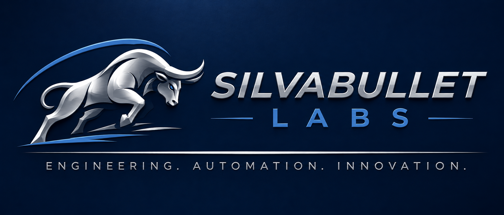

  

## Practical engineering. Purpose-built tools.

I'm Kalani Silva, a CCIE Emeritus with nearly three decades of hands-on network and infrastructure engineering experience.

**SilvaBullet Labs** is my personal engineering workspace: a place to explore ideas, automate repetitive tasks, and build useful tools that solve real-world problems.

### Focus areas

| Discipline | Focus |
|:--|:--|
| Network architecture | Enterprise connectivity, resilience and modernization |
| Infrastructure | Data center, compute and cloud |
| Automation | Scripting, workflow optimization and repeatable processes |
| Engineering tools | Practical utilities and data reconciliation |

### Engineering principles

- Solve the actual problem.
- Favor simplicity over unnecessary complexity.
- Build for reliability, maintainability and repeatability.
- Document decisions, not just configurations.

---

<strong>Complexity is inevitable. Complication is optional.</strong>

